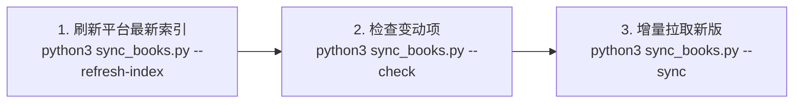

# ChinaK12Books

> **项目说明**：本仓库是基于国家中小学智慧教育平台（`basic.smartedu.cn`）构建的 **K12 全学段、全学科电子教材知识库与版本追踪管理系统**。  
> 按照规范化的 `学段 / 学科 / 版本-出版社 / 年级` 体系组织，并为每本教材智能标注**修订版本号（如：`2024修订版`、`2022修订版`、`2019课标版`）**，内置自动化增量比对更新引擎，支持定期（如每10天）一键检测与平滑更新。

---

## 目录

1. [项目结构规范](#项目结构规范)
2. [版本号标记说明](#版本号标记说明)
3. [快速开始与使用指南](#快速开始与使用指南)
   - [初始化目录树与元数据清单](#1-初始化目录树与元数据清单)
   - [检查版本差异（增量检测）](#2-检查版本差异增量检测)
   - [增量同步与批量下载](#3-增量同步与批量下载)
4. [每10天定期更新工作流](#每10天定期更新工作流)
5. [元数据清册（Manifest）说明](#元数据清册manifest说明)
6. [关于 Git 仓库与大文件管理](#关于-git-仓库与大文件管理)

---

## 项目结构规范

本仓库目录层级严格对齐 [scott20201225/ChinaTextbook](https://github.com/scott20201225/ChinaTextbook) 的标准结构：

```
ChinaK12Books/
├── README.md                      # 本文档
├── .gitignore                     # Git 规则配置（忽略二进制大文件，保留目录结构）
├── sync_books.py                  # 核心同步与增量版本比对引擎
├── textbooks_manifest.json        # 全量教材元数据与版本总库（JSON 格式，共 3239 本）
├── textbooks_manifest.csv         # 全量教材清单表格（可用 Excel/Numbers 查阅编辑）
├── 小学/
│   ├── 数学/
│   │   ├── 人教版-人民教育出版社/
│   │   │   ├── 一年级/
│   │   │   │   └── 人教版（根据2022年版课程标准修订）义务教育教科书·数学一年级上册 [2022修订版].pdf
│   │   │   └── ...
│   ├── 语文/
│   │   └── 统编版-人民教育出版社/
│   └── 英语/
├── 初中/
│   ├── 数学/
│   │   ├── 人教版-人民教育出版社/
│   │   │   ├── 七年级/
│   │   │   ├── 八年级/
│   │   │   └── 九年级/
│   │   ├── 北师大版-北京师范大学出版社/
│   │   └── 苏科版-江苏凤凰科学技术出版社/
│   ├── 物理/
│   └── 化学/
├── 高中/
│   ├── 数学/
│   │   └── 人教版（A版）-人民教育出版社/
│   └── 物理/
├── 小学（五•四学制）/
├── 初中（五•四学制）/
└── 特殊教育/
```

---

## 版本号标记说明

国家平台上的教材会伴随教育部新课标（如 2024 年秋季起义务教育全国换用新课标教材）不定期发生修订、改版或勘误。为避免盲目全量重下，本项目在**文件名**和**元数据**中均显式标记版本号：

| 版本号标记 | 典型代表 / 适用阶段 | 说明 |
| :--- | :--- | :--- |
| **`[2024修订版]`** | 2024秋季全新审定教材 | 义务教育新课标（小学一年级、初中一年级率先换新版） |
| **`[2022修订版]`** | 根据2022年课程标准修订 | 现行主流义务教育教材（多数小初学段） |
| **`[2019课标版]`** | 普通高中统编教材 | 2017/2019高中新课标必修与选择性必修 |
| **`[2012课标版]`** | 2011/2012课标义务教育教科书 | 部分过渡期高年级教材（如九年级下册） |
| **`[第X版]`** | 显式标注版次的特殊专业/大学教材 | 如第2版、第4版等 |

> **核心价值**：  
> 当教育部或出版社在平台上发布新课标教材（如 `2022修订版` 升级为 `2024修订版`）时，增量引擎会自动识别版本号差异，仅下载新版，绝不重复拉取未变动的课本。

---

## 快速开始与使用指南

本项目所有同步操作均由自带的 [`sync_books.py`](sync_books.py) 脚本驱动。无需安装额外重型环境，仅依赖 Python 3 和 `requests`。

### 1. 初始化目录树与元数据清单
如果你刚克隆本仓库，可以一行命令在本地生成全部 1135 个分类目录与最新元数据索引：
```bash
python3 sync_books.py --init
```
- 该命令秒级完成，不会下载大文件，但会在本地构建出完整的规范树状目录。

---

### 2. 检查版本差异（增量检测）
在下载或更新前，可随时运行差异检测：
```bash
python3 sync_books.py --check
```
**输出示例**：
```
============================================================
📊 本地与云端教材版本比对报告
============================================================
🟢 本地已是最新版本 (无需更新): 186 本
🟡 本地尚未下载 (待同步):       3053 本
🔴 检测到版本/内容变化 (待更新): 0 本
============================================================
```

---

### 3. 增量同步与批量下载

#### 场景 A：下载全国通用主流【人教版/统编版】全部教材（推荐首选，约 5~8 GB）
```bash
python3 sync_books.py --sync --version 人教版
python3 sync_books.py --sync --version 统编版
```

#### 场景 B：下载指定学科（如小学+初中+高中全套数学）
```bash
python3 sync_books.py --sync --subject 数学
```

#### 场景 C：下载指定学段与学科（如初中物理）
```bash
python3 sync_books.py --sync --stage 初中 --subject 物理
```

#### 场景 D：一次性全量下载所有课本（全平台 3239 本，约 40 GB）
```bash
python3 sync_books.py --sync --workers 6
```
> 支持随时 `Ctrl+C` 中断，重新运行会自动跳过已下载完成的文件，具备完整断点续传能力。

---

## 每10天定期更新工作流

如果你希望每 10 天维护一次教材库，只需执行以下 2 步：



1. **刷新平台最新索引并检测变动**：
   ```bash
   python3 sync_books.py --refresh-index --check
   ```
   引擎会抓取国家智慧教育平台最新的资源清单，并与本地已有文件的版本号、大小进行智能比对。

2. **执行增量更新**：
   ```bash
   python3 sync_books.py --sync
   ```
   - 对于本地版本已是最新教材：**自动跳过（0 流量消耗）**；
   - 对于平台新增的教材、或发生改版升级（如 2024 新修订）的教材：**仅自动拉取变动教材**并归档到对应目录。

---

## 元数据清册（Manifest）说明

在仓库根目录下维护了两份总库清册：
- [`textbooks_manifest.json`](textbooks_manifest.json)：机器可读的结构化 JSON 数据库，记录每本书的 ID、学段、学科、出版社、年级、版本标签、文件大小及存储相对路径。
- [`textbooks_manifest.csv`](textbooks_manifest.csv)：包含 12 项字段的表格，支持通过 Excel、Numbers 或 Pandas 进行检索和二次分析。

---

## 关于 Git 仓库与大文件管理

- **防爆仓机制**：全套教材体积超过 40 GB，且单个 PDF 经常超过 50MB~100MB（会触发 GitHub 的单文件 100MB 拒绝推送限制）。
- 因此本仓库已通过 `.gitignore` 自动忽略 `*.pdf` 二进制文件，保留完备的目录骨架（`.gitkeep`）、元数据索引与自动化同步脚本。
- 无论在任何环境部署，只需克隆本仓库后运行 `python3 sync_books.py --sync`，即可按需或全量将 PDF 下载入对应目录。
